# 🏡 Awesome-Smart-Home-IOT-Automation

<div align="center">

<a href="https://github.com/ishandutta2007/Awesome-Awesome-Awesome"></a><a href="https://discord.gg/jc4xtF58Ve"></a>
<a href="https://github.com/ishandutta2007/Awesome-Smart-Home-IOT-Automation/stargazers"></a>
<a href="https://github.com/ishandutta2007/Awesome-Smart-Home-IOT-Automation/network/members"></a>
<a href="https://github.com/ishandutta2007"></a>

<br/>
<br/>



<br/>

### 🌟 Top Smart Home & IoT Automation Ecosystem 🚀

**Curated List of SaaS/Hosted Platforms & Open-Source GitHub Projects**  
*Focused on Local-First Smart Home Hubs, Automation Engines, Custom Firmware, MQTT/Matter Bridges & Self-Hosted Control*

**Last updated: November 2026** 📅

</div>

---

## 📖 Table of Contents

- [🌐 Sector Overview & Market Dynamics](#-sector-overview--market-dynamics)
- [☁️ SaaS & Hosted Platforms](#️-saas--hosted-platforms)
- [🔓 Open-Source GitHub Projects](#-open-source-github-projects)
- [🛠️ Recommended Architecture Stacks](#️-recommended-architecture-stacks)
- [🤝 How to Contribute](#-how-to-contribute)
- [☕ Support](#-support)
- [📈 Star History](#-star-history)
- [⚠️ Disclaimer](#️-disclaimer)

---

## 🌐 Sector Overview & Market Dynamics

The global smart home and IoT automation market is estimated at **$105–120 billion in 2024–2026** and is projected to surpass **$230 billion by 2030** (growing at a ~12–15% CAGR), driven by ambient energy management, smart security, and the mainstream adoption of Matter/Thread standards. The sector exhibits a **moderately fragmented landscape with bifurcated concentration**: massive Big Tech ecosystems (Apple, Google, Samsung) and specialized enterprise providers dominate cloud voice, proprietary hardware, and consumer retail, while an aggressive, highly vibrant open-source and local-first ecosystem (Home Assistant, ESPHome, MQTT/Zigbee communities) captures privacy-conscious power users, home-labbers, and edge builders resisting vendor lock-in.

---

## ☁️ SaaS & Hosted Platforms

The table below catalogs major hosted and SaaS smart home ecosystems, sorted in descending order by parent company scale (valuation or annual revenue).

| Platform / Ecosystem 📱 | Company Valuation / Revenue 🏢 | Pricing (Starting Paid Tier) 💳 | Free Tier / Trial Limits 🎁 | Primary Protocol & Automation Focus 🔌 |
| :--- | :--- | :--- | :--- | :--- |
| **[Apple Home (HomeKit)](https://apple.com)** | **~$3.4 Trillion** *(Market Cap)* | **$0.99/mo** (iCloud+ 50GB tier unlocking HomeKit Secure Video for 1 camera) | **Free forever** for unlimited local Matter/Thread/HomeKit accessories, scenes, and Siri automation using an Apple Home hub (Apple TV / HomePod) | Local Matter/Thread controller, end-to-end encrypted smart home control, and HomeKit Secure Video. |
| **[Google Home & Nest](https://google.com)** | **~$2.1 Trillion** *(Market Cap)* | **$8.00/mo** (or $80/yr for Nest Aware providing 30 days event video history) | **Free forever** for basic device control, Google Assistant voice commands, live camera streaming, and standard automation routines | Cloud & local Matter routines, Nest smart thermostats, speakers, and AI event detection. |
| **[Samsung SmartThings](https://smartthings.com)** | **~$360 Billion** *(Market Cap)* | **$3.99/mo** (SmartThings Home Monitor / Samsung Care+ IoT device protection plan) | **Free forever** for unlimited connected devices, SmartThings routines, Zigbee/Z-Wave/Matter hubs, and multi-device automations | Multi-protocol hub automation, appliances integration, Thread border routing, and Bixby/smart scenes. |
| **[Schneider Electric Wiser](https://se.com)** | **~$135 Billion** *(Market Cap)* | **~$14.99/mo** (EcoStruxure / Wiser Energy Advisor advanced electrical diagnostics) | **Free forever** for essential Wiser home app scheduling, thermostat programming, and local zigbee device pairing | Home energy optimization, smart circuit breakers, heating management, and microgrid monitoring. |
| **[Honeywell Home (Resideo)](https://honeywellhome.com)** | **~$3.2 Billion** *(Market Cap)* | **$2.99/mo** (Resideo Total Connect 2.0 basic video cloud storage per camera) | **Free forever** for basic mobile thermostat scheduling, geo-fencing routines, and leak detection alerts | HVAC zoning, smart thermostats, security sensors, and water management. |
| **[Vivint Smart Home](https://vivint.com)** | **~$2.8 Billion** *(Acquired by NRG)* | **$39.99/mo** (Vivint Smart Home Starter Monitoring plan + equipment financing) | **30-day trial period** (full equipment refund trial window; active cellular monitoring requires paid subscription) | 24/7 professional monitoring, smart locks, doorbells, surveillance, and automated home defense. |
| **[Crestron Home](https://crestron.com)** | **~$1.5 Billion** *(Annual Revenue)* | **~$500–$1,500/yr** (Crestron XiO Cloud enterprise device management license) | **90-day free trial** of Crestron XiO Cloud endpoint monitoring for certified integrators | Luxury residential & commercial AV, custom lighting panels, HVAC integration, and industrial bus control. |
| **[Wyze](https://wyze.com)** | **~$1.2 Billion** *(Valuation)* | **$3.99/mo** (or $39.99/yr for Cam Plus with AI smart person/package detection) | **Free forever** for real-time live streaming, push notifications, and 12-second cloud clip event previews (or local micro-SD continuous recording) | Budget smart cameras, smart plugs, contact sensors, and cloud trigger rules. |
| **[ThingsBoard Cloud](https://thingsboard.io)** | **~$80 Million** *(Private Valuation)* | **$10.00/mo** (Maker plan supporting up to 30 devices and 3,000,000 monthly telemetry datapoints) | **30-day free trial** with access to 10 devices, complete rule engine, and cloud analytics dashboards | Industrial & residential telemetry, visual rule engine, MQTT/CoAP broker, and custom REST RPC commands. |
| **[Particle](https://particle.io)** | **~$50 Million** *(Total Funding Raised)* | **$299.00/mo** (Growth plan with SLA, dedicated cellular data pools, and fleet OTA management) | **Free forever (Free Tier)** for up to 100 devices with 100,000 cellular/cloud data operations per month | IoT microcontroller hardware (Wi-Fi/Cellular/BLE), cloud OTA compilation, and automation webhooks. |

---

## 🔓 Open-Source GitHub Projects

All open-source repositories below are sorted in **descending order by GitHub star count**. Each project includes a custom badge linking directly to its stargazer community.

| Rank 🏆 | Project & Repository 📦 | GitHub Stars ⭐ | Architecture & Core Capabilities ⚙️ |
| :---: | :--- | :---: | :--- |
| 1 | **[Home Assistant](https://github.com/home-assistant/core)** | [](https://github.com/home-assistant/core/stargazers) | Flagship Python-based, local-first smart home platform with 3,000+ integrations, native Matter/Thread/Zigbee coordinators, and local voice pipelines. |
| 2 | **[Frigate NVR](https://github.com/blakeblackshear/frigate)** | [](https://github.com/blakeblackshear/frigate/stargazers) | Open-source local AI NVR using OpenCV and Google Coral / TensorRT to detect people, vehicles, and objects for real-time MQTT automations. |
| 3 | **[Homebridge](https://github.com/homebridge/homebridge)** | [](https://github.com/homebridge/homebridge/stargazers) | Lightweight Node.js server that emulates the Apple HomeKit API, bringing thousands of unsupported third-party IoT devices into Apple Home and Siri. |
| 4 | **[Tasmota](https://github.com/arendst/Tasmota)** | [](https://github.com/arendst/Tasmota/stargazers) | Fully local firmware for ESP8266 and ESP32 smart plugs, relays, and switches with integrated web UI, timer rules, Berry scripting, and MQTT. |
| 5 | **[Node-RED](https://github.com/node-red/node-red)** | [](https://github.com/node-red/node-red/stargazers) | Browser-based visual flow programming tool for wiring together hardware devices, MQTT brokers, REST APIs, and online smart home services. |
| 6 | **[ThingsBoard CE](https://github.com/thingsboard/thingsboard)** | [](https://github.com/thingsboard/thingsboard/stargazers) | Enterprise-grade, open-source IoT platform for device telemetry collection, interactive dashboards, and node-based visual rule processing. |
| 7 | **[WLED](https://github.com/wled/WLED)** | [](https://github.com/wled/WLED/stargazers) | Fast, feature-packed ESP32/ESP8266 firmware to control addressable LED strips (NeoPixel, WS2812B, SK6812) with Home Assistant sync and JSON/E1.31 APIs. |
| 8 | **[Zigbee2MQTT](https://github.com/Koenkk/zigbee2mqtt)** | [](https://github.com/Koenkk/zigbee2mqtt/stargazers) | Bridges Zigbee networks directly into local MQTT topics, bypassing vendor lock-in across thousands of commercial Zigbee devices. |
| 9 | **[go2rtc](https://github.com/AlexxIT/go2rtc)** | [](https://github.com/AlexxIT/go2rtc/stargazers) | Ultra-low-latency RTSP/WebRTC/HLS/HomeKit streaming server for live smart home security cameras and two-way audio intercoms. |
| 10 | **[ESPHome](https://github.com/esphome/esphome)** | [](https://github.com/esphome/esphome/stargazers) | Creates custom local sensor and actuator firmware for ESP32/ESP8266/RP2040 microcontrollers using clean, declarative YAML configurations. |
| 11 | **[Eclipse Mosquitto](https://github.com/eclipse-mosquitto/mosquitto)** | [](https://github.com/eclipse-mosquitto/mosquitto/stargazers) | High-performance, lightweight open-source message broker implementing MQTT v5.0 and v3.1.1 for instant IoT telemetry distribution. |
| 12 | **[Domoticz](https://github.com/domoticz/domoticz)** | [](https://github.com/domoticz/domoticz/stargazers) | Extremely lightweight C/C++ home automation hub optimized for low-power Raspberry Pi single-board computers with Lua and dzVents scripting. |
| 13 | **[Music Assistant](https://github.com/music-assistant/server)** | [](https://github.com/music-assistant/server/stargazers) | Music library manager and multi-room audio streaming hub unifying Spotify, Apple Music, AirPlay, Chromecast, and Sonos into Home Assistant. |
| 14 | **[Gladys Assistant](https://github.com/GladysAssistant/Gladys)** | [](https://github.com/GladysAssistant/Gladys/stargazers) | Privacy-oriented smart home automation tool built on Node.js and Docker, offering streamlined setup and automated scene execution. |
| 15 | **[Hass.io Community Add-ons](https://github.com/hassio-addons/repository)** | [](https://github.com/hassio-addons/repository/stargazers) | Curated collection of standalone microservices and tools containerized as one-click add-ons for Home Assistant OS. |
| 16 | **[Z-Wave JS UI](https://github.com/zwave-js/zwave-js-ui)** | [](https://github.com/zwave-js/zwave-js-ui/stargazers) | Modern Vue/Node.js web control panel and MQTT gateway for administering Z-Wave networks, device nodes, and mesh routing. |
| 17 | **[Pyscript](https://github.com/custom-components/pyscript)** | [](https://github.com/custom-components/pyscript/stargazers) | Home Assistant integration allowing developers to write rich, asynchronous Python scripts with triggers, state change hooks, and functions. |
| 18 | **[openHAB Core](https://github.com/openhab/openhab-core)** | [](https://github.com/openhab/openhab-core/stargazers) | Modular Java runtime powering openHAB with semantic tagging, extensive hardware bindings (KNX, EnOcean, Z-Wave), and multi-engine rule execution. |
| 19 | **[zigpy](https://github.com/zigpy/zigpy)** | [](https://github.com/zigpy/zigpy/stargazers) | Hardware-independent Python library implementing the Zigbee protocol stack used by Home Assistant ZHA and coordinator tools. |
| 20 | **[Python Matter Server](https://github.com/matter-js/python-matter-server)** | [](https://github.com/matter-js/python-matter-server/stargazers) | Matter protocol server written in Python connecting Matter over Wi-Fi/Thread controllers directly to local client interfaces. |
| 21 | **[AppDaemon](https://github.com/AppDaemon/appdaemon)** | [](https://github.com/AppDaemon/appdaemon/stargazers) | Multi-threaded environment for writing complex, event-driven smart home automation apps in object-oriented Python. |
| 22 | **[house-control](https://github.com/0xProbabillity/house-control)** | [](https://github.com/0xProbabillity/house-control/stargazers) | Live 3D spatial home control dashboard in the macOS menu bar and iOS app controlling lights, thermostats, and appliances. |
| 23 | **[Matter.js](https://github.com/matter-js/matter.js)** | [](https://github.com/matter-js/matter.js/stargazers) | Pure TypeScript implementation of the Matter standard for commissioning, nodes, clusters, and controller device emulation. |
| 24 | **[Wyoming Voice Protocol](https://github.com/OHF-Voice/wyoming)** | [](https://github.com/OHF-Voice/wyoming/stargazers) | Standardized asynchronous voice protocol powering local open-source voice assistants (Piper, Whisper, openWakeWord). |
| 25 | **[ioBroker JS Controller](https://github.com/ioBroker/ioBroker.js-controller)** | [](https://github.com/ioBroker/ioBroker.js-controller/stargazers) | Core process manager and adapter daemon for ioBroker, connecting over 500 home automation devices and building automation protocols. |

---

## 🛠️ Recommended Architecture Stacks

```
  ┌─────────────────────────────────────────────────────────────┐
  │                 Control & Automation Layer                  │
  │     [Home Assistant] ◄──► [Node-RED] ◄──► [Pyscript]        │
  └──────────────────────────────┬──────────────────────────────┘
                                 │ MQTT / WebSockets / Matter
  ┌──────────────────────────────┴──────────────────────────────┐
  │                   Coordination & Gateways                   │
  │   [Mosquitto MQTT] • [Zigbee2MQTT] • [Z-Wave JS UI] • [go2rtc]
  └──────────────────────────────┬──────────────────────────────┘
                                 │ Radio / Local IP / BLE
  ┌──────────────────────────────┴──────────────────────────────┐
  │                   Edge & Sensor Endpoints                   │
  │    [ESPHome YAML] • [Tasmota Firmware] • [WLED Controllers] │
  └─────────────────────────────────────────────────────────────┘
```

1. **The Ultimate Local-First Hub**: **Home Assistant Core** + **Node-RED** for visual rule sequencing.
2. **RF & Radio Mesh**: **Zigbee2MQTT** + **Z-Wave JS UI** backed by an **Eclipse Mosquitto** broker.
3. **Custom Microcontrollers**: **ESPHome** or **Tasmota** running on ESP32/ESP8266 boards for custom multi-sensors, relays, and air quality monitors.
4. **Local AI Vision & Security**: **Frigate NVR** + **go2rtc** using local TensorRT/Coral acceleration for zero-cloud motion classification.

---

## 🤝 How to Contribute

Contributions are warmly welcome! To propose updates or add new projects:

1. 🍴 Fork the repository.
2. 📝 Update `README.md` following the existing tabular structure, including specific pricing, accurate free limits, or verified GitHub star links.
3. 🔍 Ensure links are active and descriptions remain factual and vendor-neutral.
4. 🚀 Submit a Pull Request with a brief summary of additions.

For curated lists across other domains, explore the [Awesome-Awesome-Awesome](https://github.com/ishandutta2007/Awesome-Awesome-Awesome) hub.

---

## ☕ Support

If you found this smart home & IoT compilation helpful, please consider starring ⭐ the repository, sharing 📢 it with your fellow makers and homelabbers, or supporting ongoing curation:

<div align="center">

[](https://github.com/sponsors/ishandutta2007)

**Every bit of support helps keep these open-source and IoT resources up-to-date and accessible to all!** 🙏

</div>

---

## 📈 Star History

[](https://star-history.dera.page/#ishandutta2007/Awesome-Smart-Home-IOT-Automation&type=date&legend=top-left)
[](https://www.star-history.com/#ishandutta2007/Awesome-Smart-Home-IOT-Automation&type=date&legend=top-left)

---

## ⚠️ Disclaimer

- This is a **community-curated** reference list — not an official endorsement.
- Smart home systems frequently control physical actuators, door locks, garage openers, and high-voltage electrical circuits. Always configure hardware failsafes, segment IoT devices onto dedicated isolated VLANs, and route external connections through encrypted tunnels (e.g., WireGuard or Tailscale).
- Flashing custom firmware (`ESPHome`, `Tasmota`, `WLED`) onto AC mains hardware requires disconnecting all mains power during programming and adhering strictly to national electrical codes.
